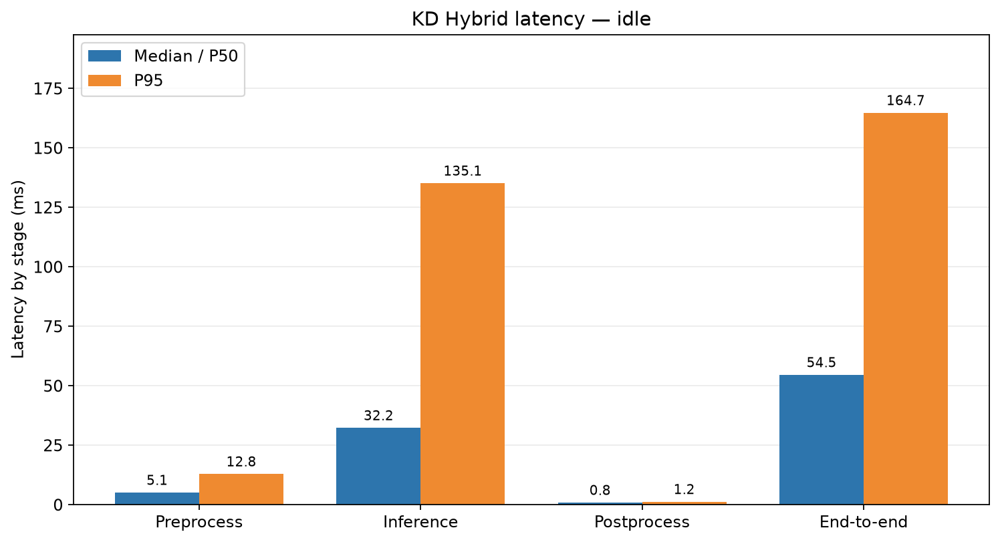
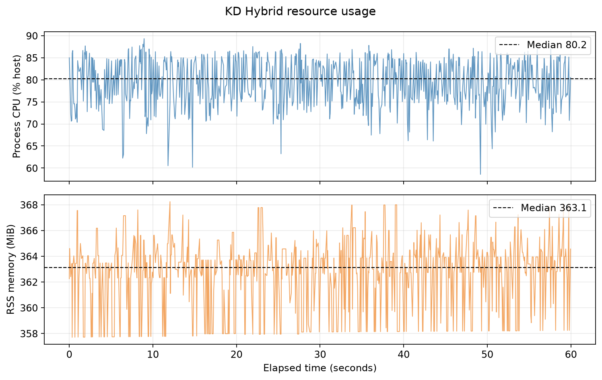
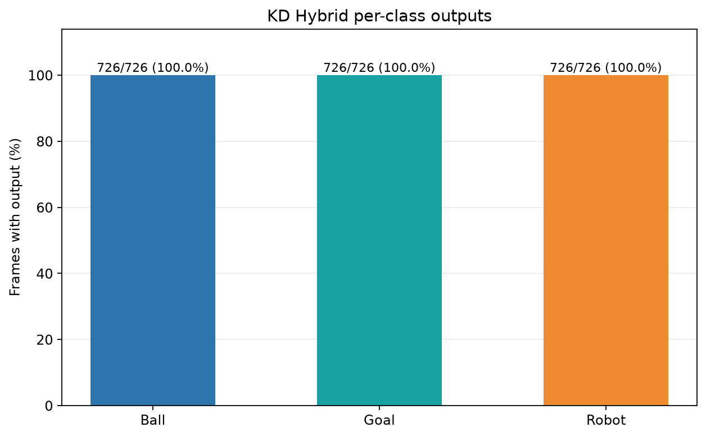

# Experiment 27 — KD Hybrid: Idle

**Result:** The idle session processed **726 frames** after 30 warm-up frames at **12.09 FPS**. Median callback latency was **54.54 ms**, P95 **164.70 ms**, with no frame errors.

## Protocol

- Run: 20261023_kd_hybrid_idle_retest_01; analyzed frames from 23 Oct 2026 01:04:17 WIB through 23 Oct 2026 01:05:17 WIB.
- KD Hybrid full seed 1337 model; checkpoint SHA-256 cd6bcb8bd9316930a14f4f1c5f6ee408e8dd64dddb52fb3c1e8773cde310b363.
- /thesis/image_raw camera at 640×480; model input 640; CPU FP32; confidence 0.25; NMS IoU 0.45; BoT-SORT; 4 intra-op and 2 inter-op threads; 16 logical CPUs.
- 30 warm-up frames excluded. SSH-X preview via /vision/debug_image remained active during measurement.
- Effective FPS = (frame count − 1) / camera timestamp span between the first and last frames in the selected window. P95 uses linear percentile.

## Performance

| Metric | Median/P50 | P95 | Unit |
|---|---:|---:|---|
| Preprocessing | 5.05 | 12.84 | ms |
| Inference | 32.23 | 135.09 | ms |
| Postprocessing | 0.83 | 1.20 | ms |
| End-to-end callback | 54.54 | 164.70 | ms |
| Process CPU, host capacity | 80.24 | 86.40 | % |
| Process RSS memory | 363.12 | 366.31 | MiB |

## Detection and tracking outputs

| Class | Frames with output | Median confidence | Track IDs |
|---|---:|---:|---|
| ball | 726/726 (100.0%) | 0.833 | 2 |
| gawang | 726/726 (100.0%) | 0.337 | 3 |
| robot | 726/726 (100.0%) | 0.858 | 1 |

KD Hybrid camera overlay example (lokal: `live_overlay_idle.png`)

## Robot state and evidence limits

The operator ran a stationary-robot session. Body joint positions differed by at most 0.00307 rad between the pre- and post-idle samples; head pan and tilt matched in both samples. No gait or head-position command was sent. OP3 manager was active, unlike the earlier pure-KD idle retest.

Box frequency, confidence, and ID persistence describe model output on this scene; they are **not accuracy measurements**. Frame-level ground truth is unavailable, so precision, recall, F1, mAP, and tracking accuracy were not calculated. This is one run per condition. No continuous video was recorded; per-frame logs and a screenshot are available.

## Artifacts

- [Metrics summary JSON](summary_metrics.json) · [performance CSV](performance_table.csv) · [detection CSV](detection_table.csv)
- [Filtered runtime window](jendela_runtime.csv) · [filtered detection window](jendela_deteksi.csv) · [screenshot metadata](live_overlay_idle.json)
- Raw runtime log (lokal: `../../../../runs/op3_pytorch/20261023_kd_hybrid_idle_retest_01.csv`) · raw detection log (lokal: `../../../../runs/op3_pytorch/20261023_kd_hybrid_idle_retest_01_detections.csv`) · run metadata (lokal: `../../../../runs/op3_pytorch/20261023_kd_hybrid_idle_retest_01.json`)
- Pre-idle telemetry (lokal: `telemetry_pre_idle.txt`) · during idle (lokal: `telemetry_during_idle.txt`) · post-idle (lokal: `telemetry_after_idle.txt`)
