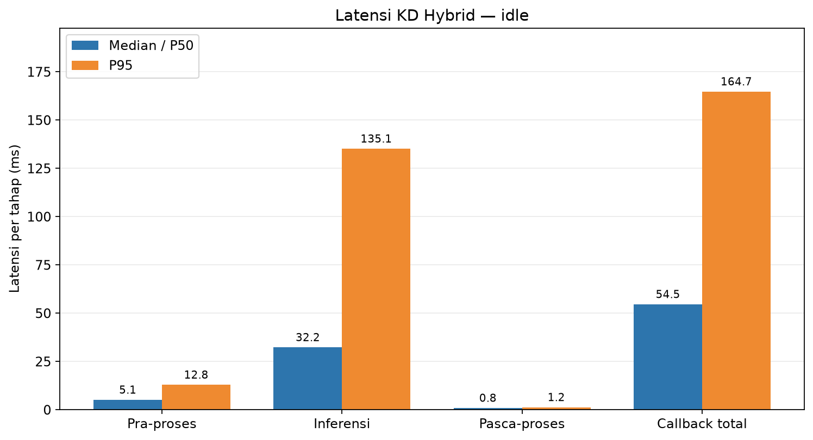
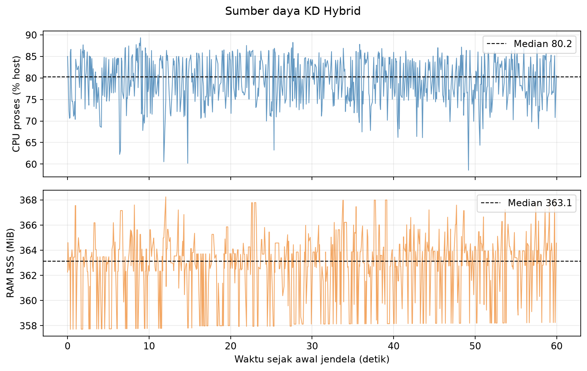
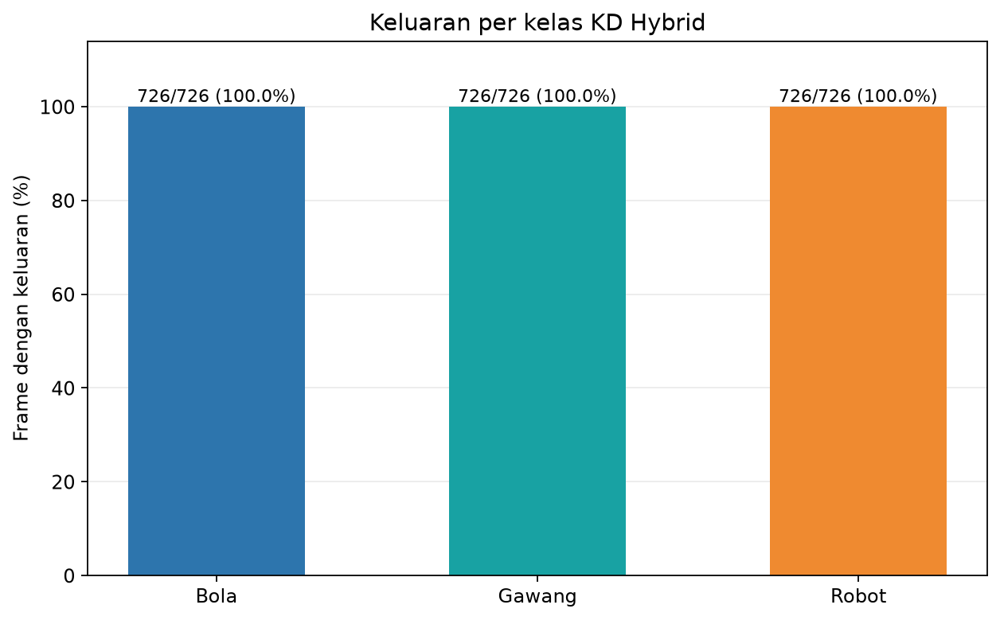

# Percobaan 27 — KD Hybrid: Idle

**Hasil:** Sesi idle memproses **726 frame** setelah 30 frame warm-up pada **12.09 FPS**. Latensi callback median **54.54 ms** dan P95 **164.70 ms**; tidak ada error frame.

## Protokol

- Run: 20261023_kd_hybrid_idle_retest_01; frame analisis dari 23 Okt 2026 01:04:17 WIB sampai 23 Okt 2026 01:05:17 WIB.
- Model KD Hybrid full seed 1337; SHA-256 checkpoint cd6bcb8bd9316930a14f4f1c5f6ee408e8dd64dddb52fb3c1e8773cde310b363.
- Kamera /thesis/image_raw 640×480; input model 640; CPU FP32; confidence 0,25; IoU NMS 0,45; BoT-SORT; 4 thread intra-op, 2 inter-op; 16 CPU logis.
- Warm-up 30 frame dikecualikan. Preview SSH-X melalui /vision/debug_image aktif sepanjang pengukuran.
- FPS efektif = (jumlah frame − 1) / selang timestamp kamera dari frame pertama ke terakhir di jendela. P95 memakai persentil linear.

## Performa

| Metrik | Median/P50 | P95 | Satuan |
|---|---:|---:|---|
| Pra-pemrosesan | 5.05 | 12.84 | ms |
| Inferensi | 32.23 | 135.09 | ms |
| Pasca-pemrosesan | 0.83 | 1.20 | ms |
| Callback total | 54.54 | 164.70 | ms |
| CPU proses, kapasitas host | 80.24 | 86.40 | % |
| RAM proses RSS | 363.12 | 366.31 | MiB |

## Keluaran deteksi dan tracking

| Kelas | Frame dengan keluaran | Median confidence | ID tracker |
|---|---:|---:|---|
| ball | 726/726 (100.0%) | 0.833 | 2 |
| gawang | 726/726 (100.0%) | 0.337 | 3 |
| robot | 726/726 (100.0%) | 0.858 | 1 |

Contoh overlay kamera KD Hybrid (lokal: `live_overlay_idle.png`)

## Kondisi robot dan batas bukti

Operator menjalankan sesi robot diam. Sampel posisi sendi sebelum dan sesudah idle berbeda paling besar 0,00307 rad pada badan; pan dan tilt kepala sama pada kedua sampel. Tidak ada perintah gait atau posisi kepala selama sesi. OP3 manager aktif, berbeda dari uji idle KD murni sebelumnya yang dibuat tanpa manager.

Frekuensi kotak, confidence, dan kestabilan ID adalah pengamatan model pada adegan ini, **bukan ukuran akurasi**. Tidak tersedia ground truth per frame untuk menghitung precision, recall, F1, mAP, atau akurasi tracking. Ini satu run per kondisi; tidak ada video kontinu, tetapi log per frame dan screenshot tersedia.

## Artefak

- [Ringkasan metrik JSON](summary_metrics.json) · [tabel performa CSV](tabel_performa.csv) · [tabel deteksi CSV](tabel_deteksi.csv)
- [Jendela runtime terfilter](jendela_runtime.csv) · [jendela deteksi terfilter](jendela_deteksi.csv) · [metadata screenshot](live_overlay_idle.json)
- Log runtime mentah (lokal: `../../../../runs/op3_pytorch/20261023_kd_hybrid_idle_retest_01.csv`) · log deteksi mentah (lokal: `../../../../runs/op3_pytorch/20261023_kd_hybrid_idle_retest_01_detections.csv`) · metadata run (lokal: `../../../../runs/op3_pytorch/20261023_kd_hybrid_idle_retest_01.json`)
- Telemetry awal (lokal: `telemetry_pre_idle.txt`) · saat idle (lokal: `telemetry_during_idle.txt`) · akhir (lokal: `telemetry_after_idle.txt`)
