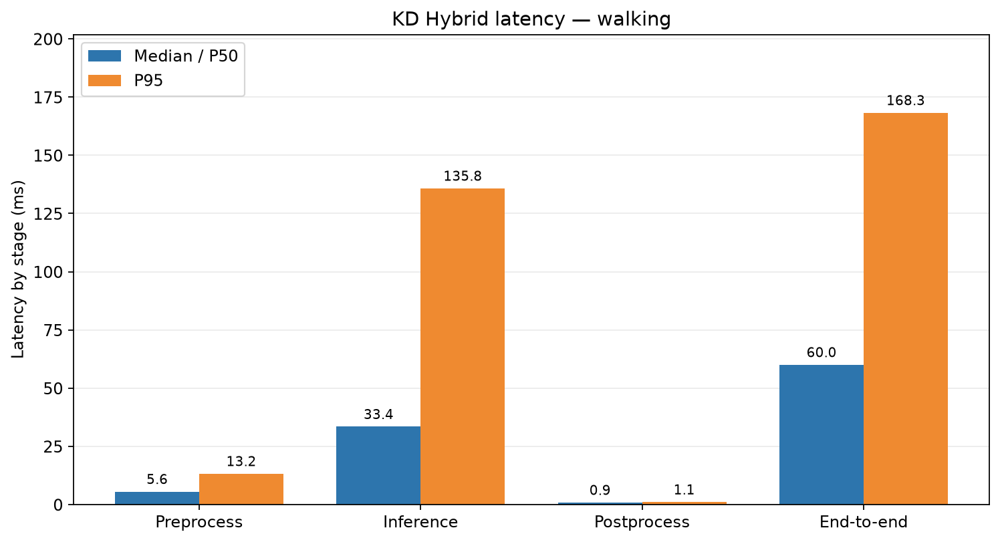
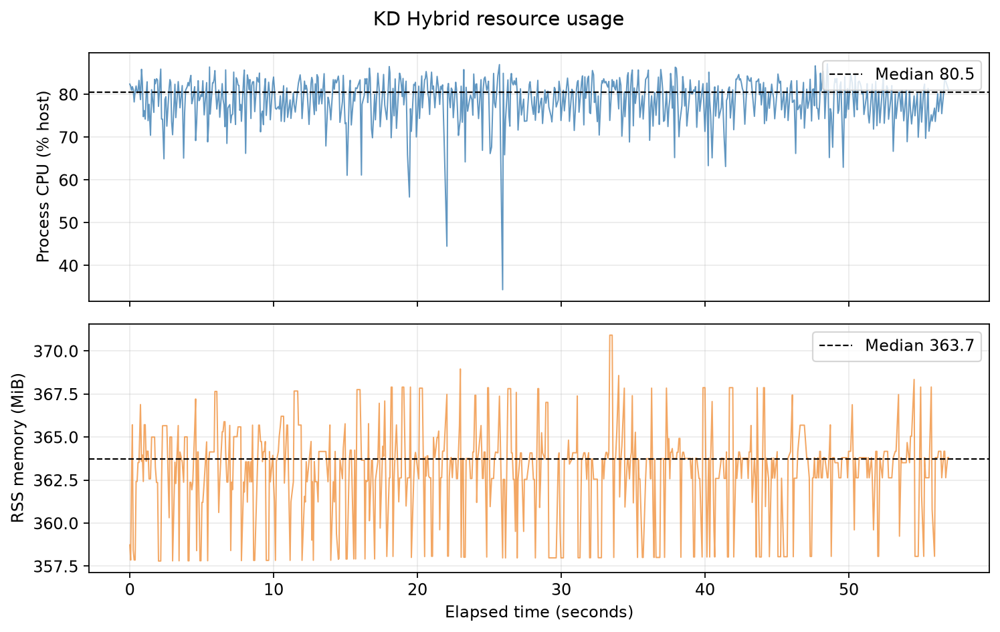
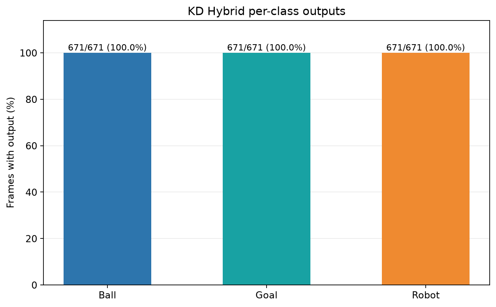

# Experiment 27 — KD Hybrid: Walking

**Result:** Within a conservative **57.01-second** gait window, KD Hybrid processed **671 frames** at **11.76 FPS**. Median callback latency was **60.03 ms**, P95 **168.26 ms**, with no frame errors.

## Protocol

- Run: 20261023_kd_hybrid_walking_retest_01; analyzed frames from 23 Oct 2026 01:06:41 WIB through 23 Oct 2026 01:07:38 WIB.
- KD Hybrid full seed 1337 model; checkpoint SHA-256 cd6bcb8bd9316930a14f4f1c5f6ee408e8dd64dddb52fb3c1e8773cde310b363.
- /thesis/image_raw camera at 640×480; model input 640; CPU FP32; confidence 0.25; NMS IoU 0.45; BoT-SORT; 4 intra-op and 2 inter-op threads; 16 logical CPUs.
- 30 warm-up frames excluded. SSH-X preview via /vision/debug_image remained active during measurement.
- Effective FPS = (frame count − 1) / camera timestamp span between the first and last frames in the selected window. P95 uses linear percentile.

## Performance

| Metric | Median/P50 | P95 | Unit |
|---|---:|---:|---|
| Preprocessing | 5.56 | 13.24 | ms |
| Inference | 33.44 | 135.79 | ms |
| Postprocessing | 0.86 | 1.07 | ms |
| End-to-end callback | 60.03 | 168.26 | ms |
| Process CPU, host capacity | 80.53 | 84.84 | % |
| Process RSS memory | 363.72 | 367.81 | MiB |

## Detection and tracking outputs

| Class | Frames with output | Median confidence | Track IDs |
|---|---:|---:|---|
| ball | 671/671 (100.0%) | 0.838 | 2 |
| gawang | 671/671 (100.0%) | 0.403 | 3 |
| robot | 671/671 (100.0%) | 0.854 | 1 |

The raw run includes frames before and after gait. All numbers and graphs in this report use only the window recorded in summary_metrics.json.

KD Hybrid camera overlay example (lokal: `live_overlay_walking.png`)

## Robot state and evidence limits

The operator confirmed walk-ready pose, a clear motion area, and supervision. Standard gait start and stop commands were 60.01 seconds apart. The analysis window begins 2 seconds after start acknowledgment and ends 1 second before stop. Two mid-gait samples show hip and knee movement; two post-stop samples show stable leg positions. Head pan did not change; tilt varied by about one servo count during gait and returned to its starting reading. No position target was sent to IDs 19/20.

Box frequency, confidence, and ID persistence describe model output on this scene; they are **not accuracy measurements**. Frame-level ground truth is unavailable, so precision, recall, F1, mAP, and tracking accuracy were not calculated. This is one run per condition. No continuous video was recorded; per-frame logs and a screenshot are available.

## Artifacts

- [Metrics summary JSON](summary_metrics.json) · [performance CSV](performance_table.csv) · [detection CSV](detection_table.csv)
- [Filtered runtime window](jendela_runtime.csv) · [filtered detection window](jendela_deteksi.csv) · [screenshot metadata](live_overlay_walking.json)
- Raw runtime log (lokal: `../../../../runs/op3_pytorch/20261023_kd_hybrid_walking_retest_01.csv`) · raw detection log (lokal: `../../../../runs/op3_pytorch/20261023_kd_hybrid_walking_retest_01_detections.csv`) · run metadata (lokal: `../../../../runs/op3_pytorch/20261023_kd_hybrid_walking_retest_01.json`)
- Start time (lokal: `gait_start_ack_utc.txt`) · start command (lokal: `gait_start_command.txt`) · stop time (lokal: `gait_stop_sent_utc.txt`) · stop command (lokal: `gait_stop_command.txt`)
- Pre-gait telemetry (lokal: `telemetry_pre_gait.txt`) · mid-gait 1 (lokal: `telemetry_gait_sample_1.txt`) · mid-gait 2 (lokal: `telemetry_gait_sample_2.txt`) · post-stop 1 (lokal: `telemetry_after_gait_1.txt`) · post-stop 2 (lokal: `telemetry_after_gait_2.txt`)
