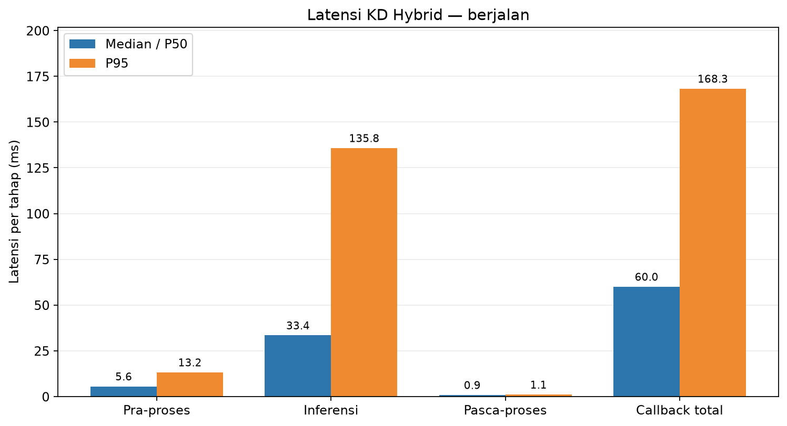
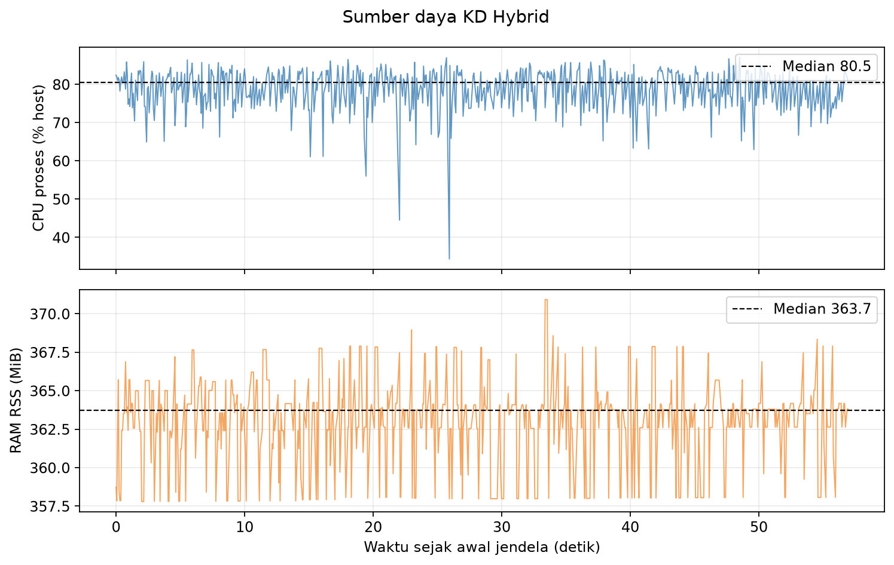
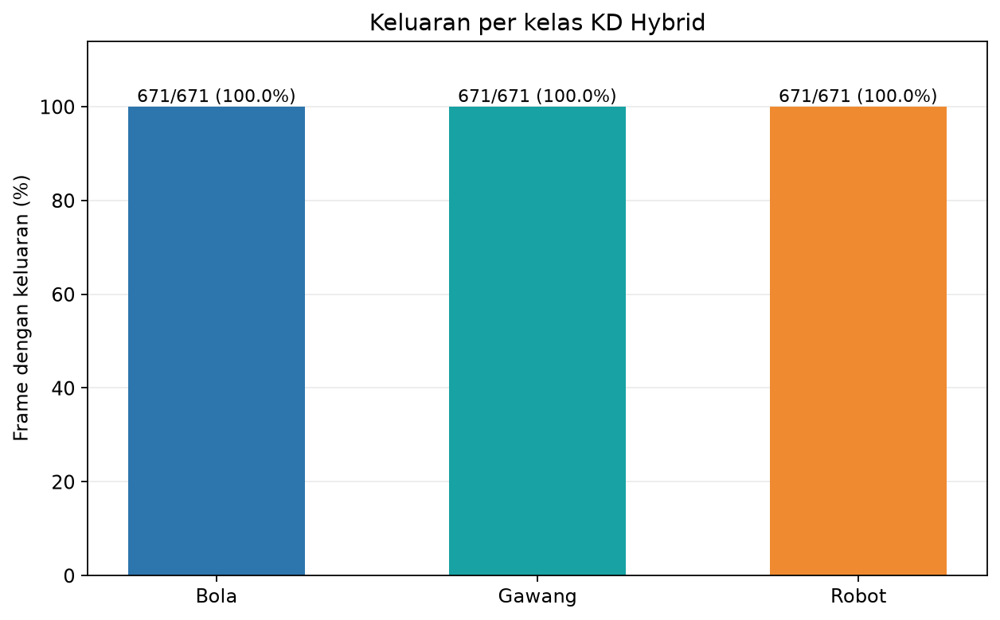

# Percobaan 27 — KD Hybrid: Berjalan

**Hasil:** Dalam jendela gait konservatif **57.01 detik**, KD Hybrid memproses **671 frame** pada **11.76 FPS**. Latensi callback median **60.03 ms**, P95 **168.26 ms**, tanpa error frame.

## Protokol

- Run: 20261023_kd_hybrid_walking_retest_01; frame analisis dari 23 Okt 2026 01:06:41 WIB sampai 23 Okt 2026 01:07:38 WIB.
- Model KD Hybrid full seed 1337; SHA-256 checkpoint cd6bcb8bd9316930a14f4f1c5f6ee408e8dd64dddb52fb3c1e8773cde310b363.
- Kamera /thesis/image_raw 640×480; input model 640; CPU FP32; confidence 0,25; IoU NMS 0,45; BoT-SORT; 4 thread intra-op, 2 inter-op; 16 CPU logis.
- Warm-up 30 frame dikecualikan. Preview SSH-X melalui /vision/debug_image aktif sepanjang pengukuran.
- FPS efektif = (jumlah frame − 1) / selang timestamp kamera dari frame pertama ke terakhir di jendela. P95 memakai persentil linear.

## Performa

| Metrik | Median/P50 | P95 | Satuan |
|---|---:|---:|---|
| Pra-pemrosesan | 5.56 | 13.24 | ms |
| Inferensi | 33.44 | 135.79 | ms |
| Pasca-pemrosesan | 0.86 | 1.07 | ms |
| Callback total | 60.03 | 168.26 | ms |
| CPU proses, kapasitas host | 80.53 | 84.84 | % |
| RAM proses RSS | 363.72 | 367.81 | MiB |

## Keluaran deteksi dan tracking

| Kelas | Frame dengan keluaran | Median confidence | ID tracker |
|---|---:|---:|---|
| ball | 671/671 (100.0%) | 0.838 | 2 |
| gawang | 671/671 (100.0%) | 0.403 | 3 |
| robot | 671/671 (100.0%) | 0.854 | 1 |

Run mentah memuat frame sebelum dan sesudah gait. Seluruh angka dan grafik laporan ini memakai hanya jendela yang tercantum pada summary_metrics.json.

Contoh overlay kamera KD Hybrid (lokal: `live_overlay_walking.png`)

## Kondisi robot dan batas bukti

Operator mengonfirmasi robot walk-ready, area kosong, dan pendampingan. Perintah start dan stop gait standar berjarak 60,01 detik. Jendela analisis dimulai 2 detik setelah start diterima dan berakhir 1 detik sebelum stop dikirim. Dua sampel di tengah menunjukkan perubahan posisi pinggul dan lutut; dua sampel sesudah stop menunjukkan sendi kaki stabil. Pan kepala tidak berubah; tilt berbeda sekitar satu hitungan pada sampel tengah dan kembali ke nilai awal. Tidak ada target posisi yang dikirim ke ID 19/20.

Frekuensi kotak, confidence, dan kestabilan ID adalah pengamatan model pada adegan ini, **bukan ukuran akurasi**. Tidak tersedia ground truth per frame untuk menghitung precision, recall, F1, mAP, atau akurasi tracking. Ini satu run per kondisi; tidak ada video kontinu, tetapi log per frame dan screenshot tersedia.

## Artefak

- [Ringkasan metrik JSON](summary_metrics.json) · [tabel performa CSV](tabel_performa.csv) · [tabel deteksi CSV](tabel_deteksi.csv)
- [Jendela runtime terfilter](jendela_runtime.csv) · [jendela deteksi terfilter](jendela_deteksi.csv) · [metadata screenshot](live_overlay_walking.json)
- Log runtime mentah (lokal: `../../../../runs/op3_pytorch/20261023_kd_hybrid_walking_retest_01.csv`) · log deteksi mentah (lokal: `../../../../runs/op3_pytorch/20261023_kd_hybrid_walking_retest_01_detections.csv`) · metadata run (lokal: `../../../../runs/op3_pytorch/20261023_kd_hybrid_walking_retest_01.json`)
- Waktu start (lokal: `gait_start_ack_utc.txt`) · perintah start (lokal: `gait_start_command.txt`) · waktu stop (lokal: `gait_stop_sent_utc.txt`) · perintah stop (lokal: `gait_stop_command.txt`)
- Telemetry sebelum (lokal: `telemetry_pre_gait.txt`) · tengah 1 (lokal: `telemetry_gait_sample_1.txt`) · tengah 2 (lokal: `telemetry_gait_sample_2.txt`) · sesudah stop 1 (lokal: `telemetry_after_gait_1.txt`) · sesudah stop 2 (lokal: `telemetry_after_gait_2.txt`)
