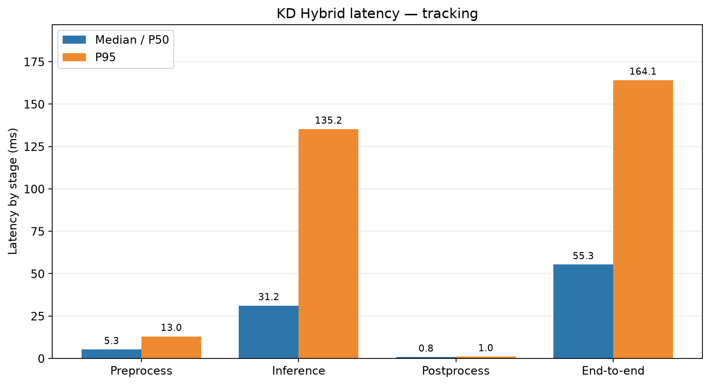
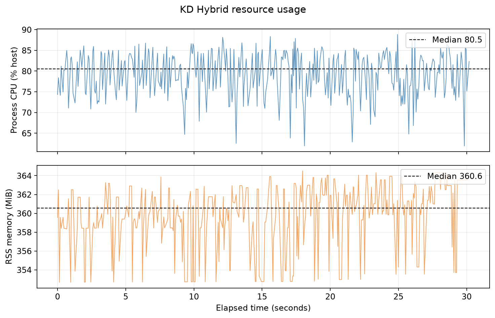
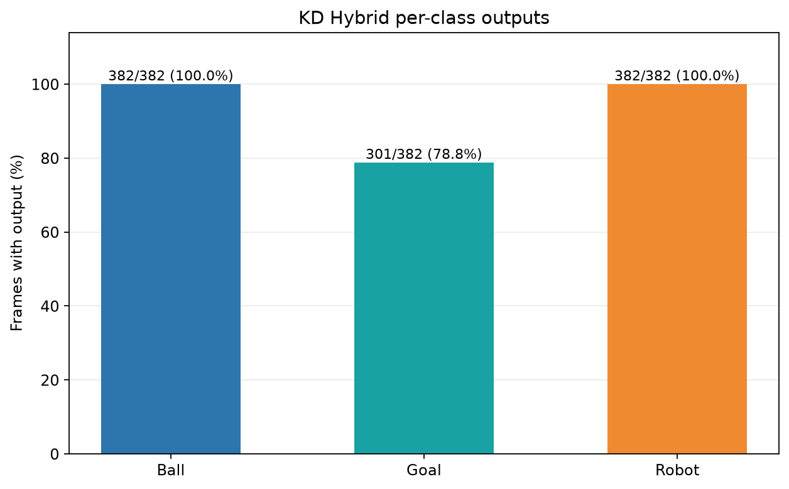
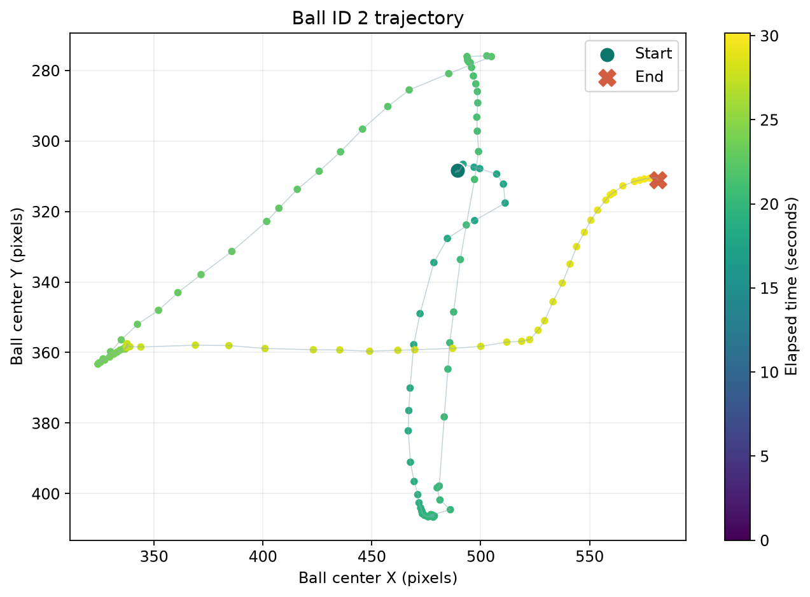
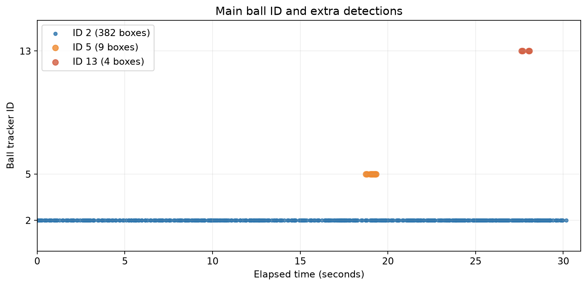

# Experiment 27 — KD Hybrid: Ball tracking

**Result:** During moving-ball tracking, **382 frames** were processed at **12.63 FPS**. Ball track ID 2 appeared in **382/382 frames**; its center spanned **257.2 px** horizontally and **130.8 px** vertically. Median callback latency was **55.34 ms**, P95 **164.15 ms**.

## Protocol

- Run: 20261023_kd_hybrid_tracking_moving_ball_01; analyzed frames from 23 Oct 2026 01:08:29 WIB through 23 Oct 2026 01:08:59 WIB.
- KD Hybrid full seed 1337 model; checkpoint SHA-256 cd6bcb8bd9316930a14f4f1c5f6ee408e8dd64dddb52fb3c1e8773cde310b363.
- /thesis/image_raw camera at 640×480; model input 640; CPU FP32; confidence 0.25; NMS IoU 0.45; BoT-SORT; 4 intra-op and 2 inter-op threads; 16 logical CPUs.
- 30 warm-up frames excluded. SSH-X preview via /vision/debug_image remained active during measurement.
- Effective FPS = (frame count − 1) / camera timestamp span between the first and last frames in the selected window. P95 uses linear percentile.

## Performance

| Metric | Median/P50 | P95 | Unit |
|---|---:|---:|---|
| Preprocessing | 5.25 | 13.01 | ms |
| Inference | 31.16 | 135.25 | ms |
| Postprocessing | 0.80 | 1.03 | ms |
| End-to-end callback | 55.34 | 164.15 | ms |
| Process CPU, host capacity | 80.48 | 85.95 | % |
| Process RSS memory | 360.57 | 363.93 | MiB |

## Detection and tracking outputs

| Class | Frames with output | Median confidence | Track IDs |
|---|---:|---:|---|
| ball | 382/382 (100.0%) | 0.831 | 2, 5, 13 |
| gawang | 301/382 (78.8%) | 0.384 | 3, 21 |
| robot | 382/382 (100.0%) | 0.866 | 1 |

Main track ID 2 persisted throughout all 382 frames, but **13 frames** also had extra ball boxes (ID 5 in 9 frames and ID 13 in 4). In the screenshot, the operator's hand is boxed as ball ID 5: a visually verifiable false detection. The goal produced boxes in 301/382 frames; its ID changed from 3 to 21 after a gap. These are tracker outputs from one session, not tracking accuracy.

KD Hybrid camera overlay example (lokal: `live_overlay_tracking.png`)

## Robot state and evidence limits

Gait had been stopped and two subsequent leg-joint samples were stable. The operator moved the ball for about 30 seconds; no gait or servo command was sent during tracking. The physical-condition metadata remains unknown because no separate verification was performed at this run's start.

Box frequency, confidence, and ID persistence describe model output on this scene; they are **not accuracy measurements**. Frame-level ground truth is unavailable, so precision, recall, F1, mAP, and tracking accuracy were not calculated. This is one run per condition. No continuous video was recorded; per-frame logs and a screenshot are available.

## Artifacts

- [Metrics summary JSON](summary_metrics.json) · [performance CSV](performance_table.csv) · [detection CSV](detection_table.csv)
- [Filtered runtime window](jendela_runtime.csv) · [filtered detection window](jendela_deteksi.csv) · [screenshot metadata](live_overlay_tracking.json)
- Raw runtime log (lokal: `../../../../runs/op3_pytorch/20261023_kd_hybrid_tracking_moving_ball_01.csv`) · raw detection log (lokal: `../../../../runs/op3_pytorch/20261023_kd_hybrid_tracking_moving_ball_01_detections.csv`) · run metadata (lokal: `../../../../runs/op3_pytorch/20261023_kd_hybrid_tracking_moving_ball_01.json`)
