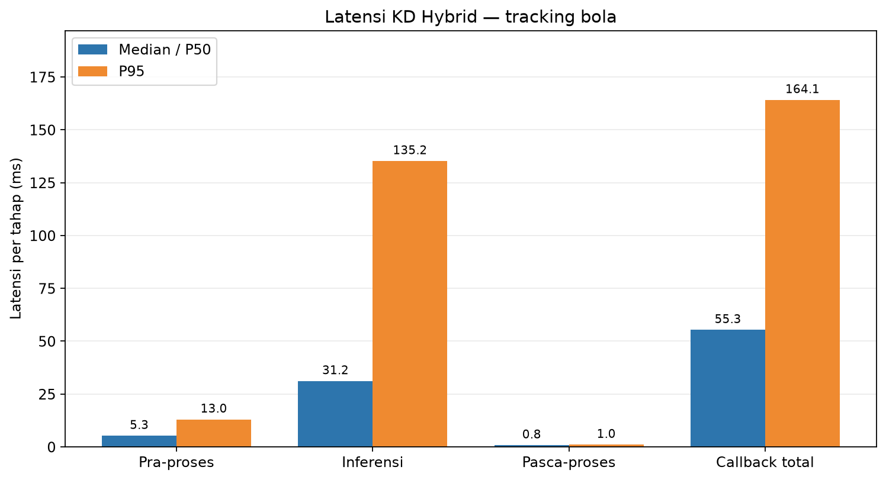
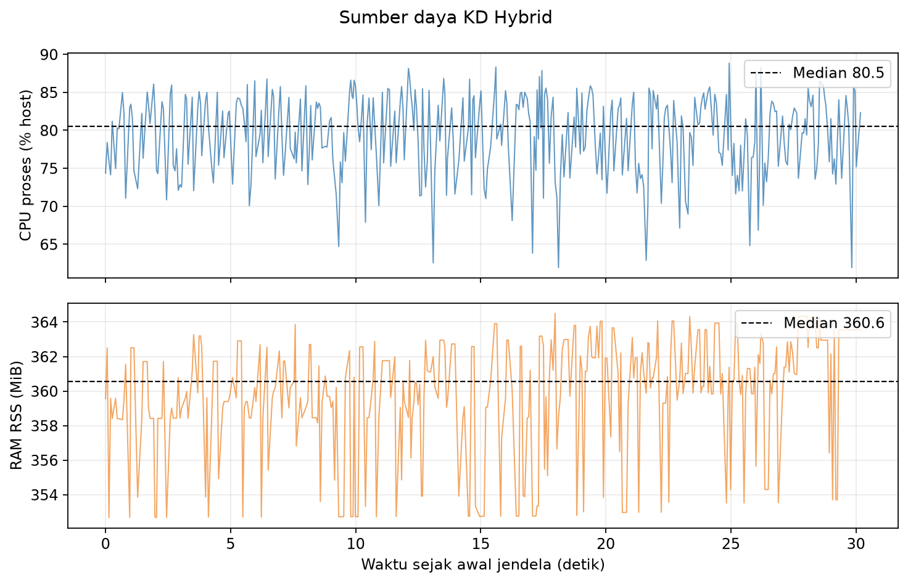
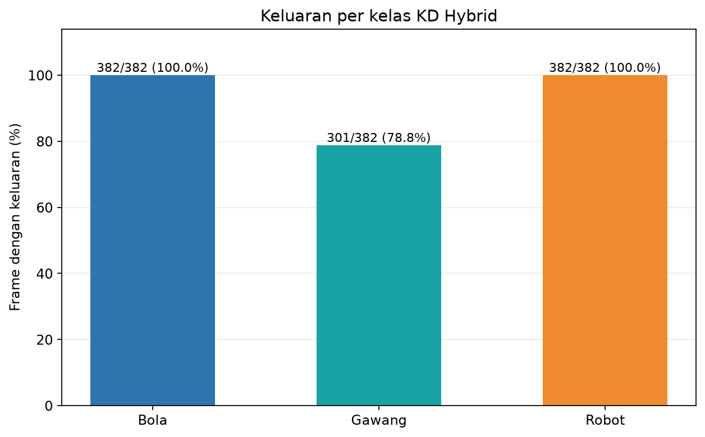
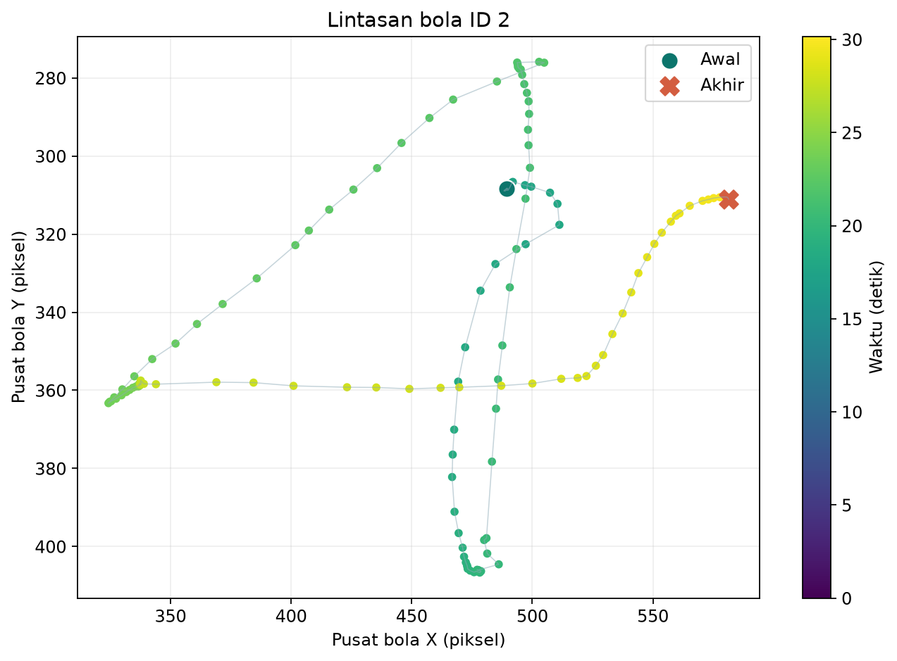
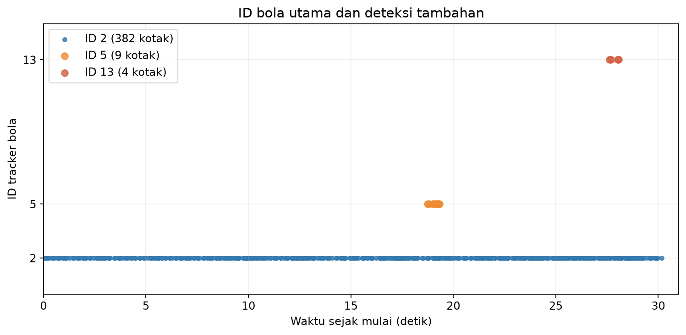

# Percobaan 27 — KD Hybrid: Tracking bola

**Hasil:** Selama sesi bola bergerak, **382 frame** diproses pada **12.63 FPS**. Track bola ID 2 muncul pada **382/382 frame**, dengan rentang pusat **257.2 px** pada X dan **130.8 px** pada Y. Latensi callback median **55.34 ms**, P95 **164.15 ms**.

## Protokol

- Run: 20261023_kd_hybrid_tracking_moving_ball_01; frame analisis dari 23 Okt 2026 01:08:29 WIB sampai 23 Okt 2026 01:08:59 WIB.
- Model KD Hybrid full seed 1337; SHA-256 checkpoint cd6bcb8bd9316930a14f4f1c5f6ee408e8dd64dddb52fb3c1e8773cde310b363.
- Kamera /thesis/image_raw 640×480; input model 640; CPU FP32; confidence 0,25; IoU NMS 0,45; BoT-SORT; 4 thread intra-op, 2 inter-op; 16 CPU logis.
- Warm-up 30 frame dikecualikan. Preview SSH-X melalui /vision/debug_image aktif sepanjang pengukuran.
- FPS efektif = (jumlah frame − 1) / selang timestamp kamera dari frame pertama ke terakhir di jendela. P95 memakai persentil linear.

## Performa

| Metrik | Median/P50 | P95 | Satuan |
|---|---:|---:|---|
| Pra-pemrosesan | 5.25 | 13.01 | ms |
| Inferensi | 31.16 | 135.25 | ms |
| Pasca-pemrosesan | 0.80 | 1.03 | ms |
| Callback total | 55.34 | 164.15 | ms |
| CPU proses, kapasitas host | 80.48 | 85.95 | % |
| RAM proses RSS | 360.57 | 363.93 | MiB |

## Keluaran deteksi dan tracking

| Kelas | Frame dengan keluaran | Median confidence | ID tracker |
|---|---:|---:|---|
| ball | 382/382 (100.0%) | 0.831 | 2, 5, 13 |
| gawang | 301/382 (78.8%) | 0.384 | 3, 21 |
| robot | 382/382 (100.0%) | 0.866 | 1 |

Track utama ID 2 bertahan sepanjang 382 frame, tetapi **13 frame** memuat kotak ball tambahan (ID 5 pada 9 frame dan ID 13 pada 4 frame). Pada screenshot, tangan operator tampak diberi kotak ball ID 5: contoh salah deteksi yang dapat diperiksa secara visual. Gawang menghasilkan kotak pada 301/382 frame dan ID-nya berganti dari 3 ke 21 setelah sempat hilang. Ini keluaran tracker pada satu sesi, bukan akurasi tracking.

Contoh overlay kamera KD Hybrid (lokal: `live_overlay_tracking.png`)

## Kondisi robot dan batas bukti

Gait sudah dihentikan dan dua sampel sendi kaki sesudah stop stabil. Operator menggerakkan bola selama kira-kira 30 detik; tidak ada perintah gait atau servo saat sesi tracking. Metadata kondisi fisik tetap unknown karena tidak ada verifikasi keadaan robot yang terpisah pada awal run ini.

Frekuensi kotak, confidence, dan kestabilan ID adalah pengamatan model pada adegan ini, **bukan ukuran akurasi**. Tidak tersedia ground truth per frame untuk menghitung precision, recall, F1, mAP, atau akurasi tracking. Ini satu run per kondisi; tidak ada video kontinu, tetapi log per frame dan screenshot tersedia.

## Artefak

- [Ringkasan metrik JSON](summary_metrics.json) · [tabel performa CSV](tabel_performa.csv) · [tabel deteksi CSV](tabel_deteksi.csv)
- [Jendela runtime terfilter](jendela_runtime.csv) · [jendela deteksi terfilter](jendela_deteksi.csv) · [metadata screenshot](live_overlay_tracking.json)
- Log runtime mentah (lokal: `../../../../runs/op3_pytorch/20261023_kd_hybrid_tracking_moving_ball_01.csv`) · log deteksi mentah (lokal: `../../../../runs/op3_pytorch/20261023_kd_hybrid_tracking_moving_ball_01_detections.csv`) · metadata run (lokal: `../../../../runs/op3_pytorch/20261023_kd_hybrid_tracking_moving_ball_01.json`)
