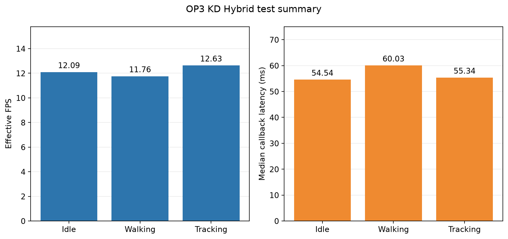

# Experiment 27 — KD Hybrid retest on OP3

**Status: complete.** Idle, walking, and moving-ball tracking used the KD Hybrid full seed 1337 model with SSH-X preview enabled. Gait was stopped and live monitoring preview was restored after the tests.

| Condition | Frames | FPS | Callback P50/P95 (ms) | Median host CPU | Median RSS | Report |
|---|---:|---:|---:|---:|---:|---|
| Idle | 726 | 12.09 | 54.54 / 164.70 | 80.24% | 363.12 MiB | [Idle](01-idle/README_EN.md) |
| Walking | 671 | 11.76 | 60.03 / 168.26 | 80.53% | 363.72 MiB | [Walking](02-berjalan/README_EN.md) |
| Ball tracking | 382 | 12.63 | 55.34 / 164.15 | 80.48% | 360.57 MiB | [Ball tracking](03-tracking/README_EN.md) |

- [Summary CSV](summary_table.csv) · [Ringkasan Indonesia](README_ID.md)
- [Idle: tables, graphs, screenshot, telemetry](01-idle/README_EN.md)
- [Walking: tables, graphs, screenshot, and joint verification](02-berjalan/README_EN.md)
- [Tracking: ball trajectory, track IDs, screenshot, and tables](03-tracking/README_EN.md)

## Configuration and interpretation

All sessions used KD Hybrid full seed 1337 checkpoint SHA-256 cd6bcb8bd9316930a14f4f1c5f6ee408e8dd64dddb52fb3c1e8773cde310b363, CPU FP32, imgsz 640, confidence 0.25, IoU 0.45, BoT-SORT, 4 intra-op and 2 inter-op threads. The 640×480 /thesis/image_raw camera and /vision/debug_image overlay were shown over SSH-X. Thirty warm-up frames were excluded. CPU is normalized to total capacity across 16 logical CPUs; RSS is process resident memory. FPS uses camera timestamps from analyzed frames.

For walking, standard gait was commanded for about 60 seconds; the table uses an inner 57-second window supported by leg-joint telemetry. IDs 19/20 received no position command, and initial/final pan and tilt readings matched. During tracking, ball ID 2 was produced in all 382 frames, but the operator's hand was incorrectly boxed as ball in the screenshot and extra ball boxes appeared in 13 frames. Goal boxes appeared in 301/382 tracking frames. **Output coverage is not accuracy.** Frame-aligned ground truth is unavailable, so precision, recall, F1, mAP, and tracking accuracy were not calculated.

There is one run per condition. FPS and latency comparisons are descriptive, especially across models tested in different sessions/scenes. Post-test preview run 01 was interrupted and is retained separately; the active monitoring run is 20261023_kd_hybrid_live_preview_post_tests_02 (lokal: `../../../runs/op3_pytorch/20261023_kd_hybrid_live_preview_post_tests_02.json`), outside the benchmarks.
