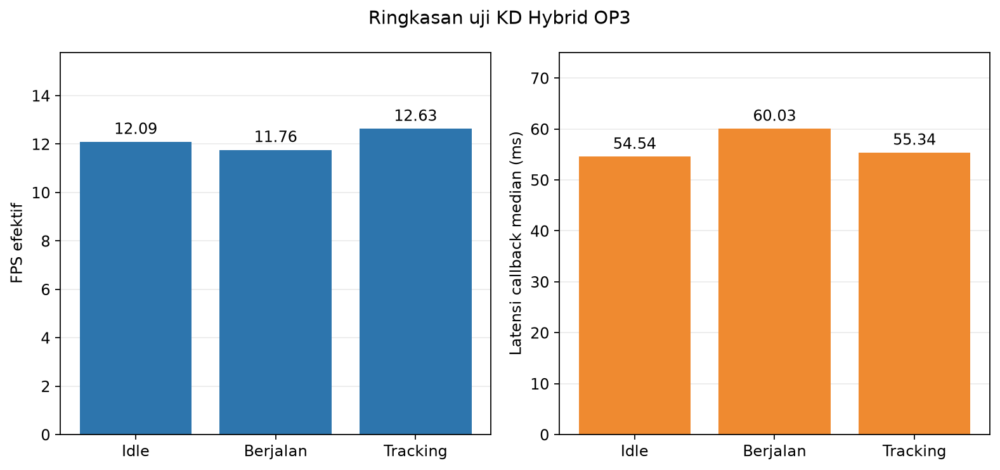

# Percobaan 27 — Uji ulang KD Hybrid di robot OP3

**Status: selesai.** Uji idle, berjalan, dan tracking bola menggunakan model KD Hybrid full seed 1337 dengan preview SSH-X aktif. Gait telah dihentikan; live preview pemantauan dinyalakan kembali setelah pengujian.

| Kondisi | Frame | FPS | Callback P50/P95 (ms) | CPU host median | RSS median | Laporan |
|---|---:|---:|---:|---:|---:|---|
| Idle | 726 | 12.09 | 54.54 / 164.70 | 80.24% | 363.12 MiB | [Idle](01-idle/README_ID.md) |
| Berjalan | 671 | 11.76 | 60.03 / 168.26 | 80.53% | 363.72 MiB | [Berjalan](02-berjalan/README_ID.md) |
| Tracking bola | 382 | 12.63 | 55.34 / 164.15 | 80.48% | 360.57 MiB | [Tracking bola](03-tracking/README_ID.md) |

- [Tabel ringkasan CSV](tabel_ringkasan.csv) · [English summary](README_EN.md)
- [Idle: tabel, grafik, screenshot, telemetry](01-idle/README_ID.md)
- [Berjalan: tabel, grafik, screenshot, dan verifikasi sendi](02-berjalan/README_ID.md)
- [Tracking: lintasan bola, ID tracker, screenshot, dan tabel](03-tracking/README_ID.md)

## Konfigurasi dan interpretasi

Ketiga sesi memakai checkpoint KD Hybrid full seed 1337 dengan SHA-256 cd6bcb8bd9316930a14f4f1c5f6ee408e8dd64dddb52fb3c1e8773cde310b363; CPU FP32; imgsz 640; confidence 0,25; IoU 0,45; BoT-SORT; 4 thread intra-op dan 2 inter-op. Kamera 640×480 dari /thesis/image_raw dan overlay /vision/debug_image ditampilkan lewat SSH-X. Warm-up 30 frame dikecualikan. CPU dinormalisasi terhadap kapasitas 16 CPU logis; RSS adalah memori resident proses. FPS dihitung dari timestamp kamera pada frame yang masuk analisis.

Pada walking, perintah gait standar berlangsung sekitar 60 detik; tabel memakai jendela 57 detik di bagian tengah dengan telemetry gerak kaki. ID 19/20 tidak menerima perintah posisi; bacaan pan dan tilt awal/akhir sama. Pada tracking, bola ID 2 terdeteksi pada seluruh 382 frame, tetapi tangan operator salah diberi kotak ball pada screenshot dan kotak ball tambahan muncul pada 13 frame. Gawang menghasilkan kotak pada 301/382 frame tracking. **Cakupan keluaran bukan akurasi.** Tidak ada label ground truth selaras frame, sehingga metrik precision, recall, F1, mAP, dan akurasi tracking tidak dihitung.

Run ini adalah satu ulangan per kondisi. Perbandingan FPS dan latensi bersifat deskriptif, terutama terhadap model lain yang diuji pada sesi/adegan berbeda. Run preview pascauji 01 sempat terinterupsi dan disimpan terpisah; run pemantauan aktif berikutnya adalah 20261023_kd_hybrid_live_preview_post_tests_02 (lokal: `../../../runs/op3_pytorch/20261023_kd_hybrid_live_preview_post_tests_02.json`), di luar benchmark.
