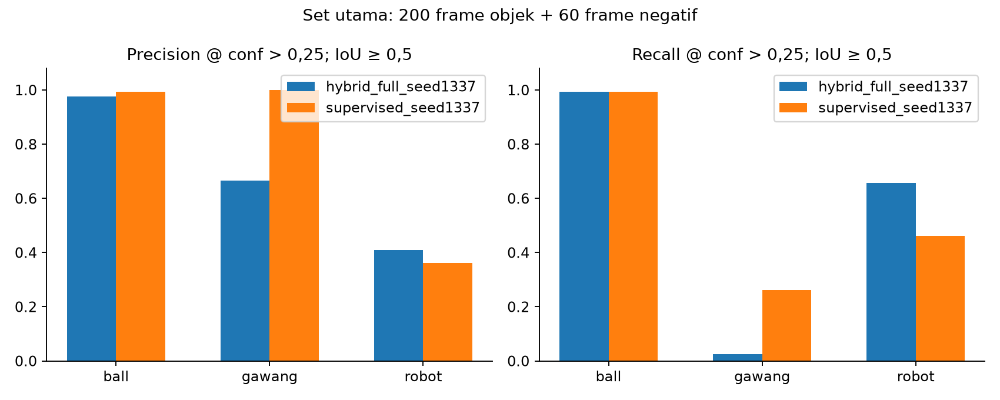
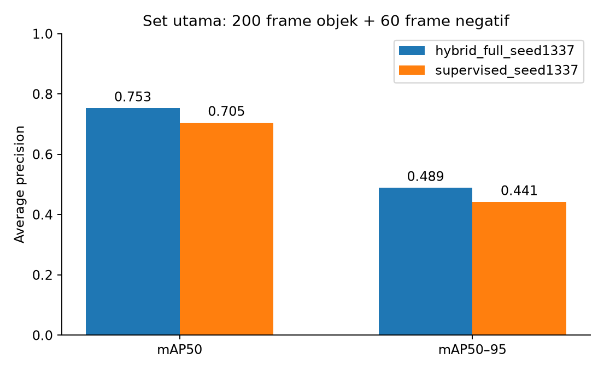

# Experiment 28 — offline KD Hybrid vs Supervised evaluation on OP3 camera frames

**Status: completed, exploratory.** The same 260 reviewed OP3 frames (200 positive and 60 negative; 400 ground-truth boxes) were evaluated with both seed-1337 checkpoints. This run used stored images and labels only; it did not command the camera, servos, or gait. The full per-class table is [T34](../../../analisis_performa/tabel/T34_akurasi_op3_hybrid_supervised_seed1337.md).

| Model | mAP50–95 | Macro precision | Macro recall | Macro F1 | Negative frames with false positives |
|---|---:|---:|---:|---:|---:|
| KD Hybrid full seed 1337 | 0.4885 | 0.6836 | 0.5583 | 0.5121 | 21/60 |
| Supervised seed 1337 | 0.4414 | 0.7855 | 0.5729 | 0.6054 | 0/60 |

AP used confidence floor 0.001; precision, recall and F1 used confidence >0.25, class-matched IoU ≥0.5 and NMS IoU 0.7. Both models ran on CPU FP32 at image size 640. Hybrid had higher mAP50–95 by 0.0471, while Supervised had higher macro F1 at the chosen operating threshold by 0.0933. Hybrid matched only 2/80 goal boxes at that threshold versus 21/80 for Supervised. The 50 partial-goal frames were evaluated separately but excluded from this comparison because their box definitions were inconsistent.

The frames came from one OP3 capture series. Draft annotations originated from a pure-KD seed-42 detector before human review, so annotation bias and scene dependence remain possible. These values are separate from Advance Vision TEST accuracy and live OP3 throughput. The [input manifest](../../../runs/op3_multi_session_eval/20261023_hybrid_supervised1337_primary260_v1/input_manifest.json), [full results](../../../runs/op3_multi_session_eval/20261023_hybrid_supervised1337_primary260_v1/results.json), per-frame predictions (lokal: `../../../runs/op3_multi_session_eval/20261023_hybrid_supervised1337_primary260_v1/per_frame_hybrid_full_seed1337.jsonl`), and [summary CSV](../../../analisis_performa/tabel/T34_akurasi_op3_hybrid_supervised_seed1337.csv) preserve the audit trail.
