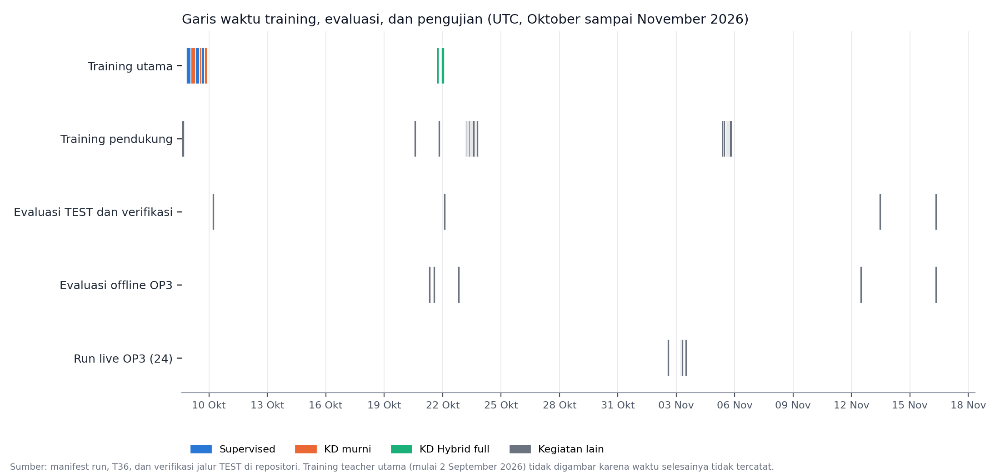

# Jejak waktu training, evaluasi, dan pengujian

Folder ini merangkum kapan setiap model dilatih, dievaluasi, dan diuji di robot. Semua angka dibaca dari
berkas yang sudah ada di repositori: manifest run (`started_at_utc`, `finished_at_utc`), kolom `time`
pada `results.csv`, tabel T36, log jendela runtime, dan hasil verifikasi jalur TEST. Waktu asli tercatat
dalam UTC; tabel di halaman ini juga menampilkannya dalam WIB (UTC+7).



## Isi folder

| Berkas | Isi |
|---|---|
| [`kronologi_kegiatan.csv`](kronologi_kegiatan.csv) | 64 kegiatan berurutan waktu: training utama dan pendukung, sesi TEST, verifikasi jalur, evaluasi offline OP3, dan 24 run live, lengkap dengan perangkat dan berkas sumber |
| [`training_per_epoch.csv`](training_per_epoch.csv) | 1000 baris: waktu kumulatif dan durasi tiap epoch, serta precision, recall, mAP50, dan mAP50-95 VAL untuk sembilan student utama dan teacher utama |
| [`timestamp_frame_live_24_run.csv`](timestamp_frame_live_24_run.csv) | Untuk tiap run live: jumlah frame, timestamp frame pertama dan terakhir, rentang timestamp kamera, jeda terbesar, dan jumlah error |
| `garis_waktu_kegiatan_id.png` | Grafik garis waktu di atas |
| [`manifest_jejak_waktu_sha256.json`](manifest_jejak_waktu_sha256.json) | SHA-256 berkas keluaran dan setiap berkas sumber |

## Training utama

| Metode | Seed | Mulai (WIB) | Selesai (WIB) | Durasi training | Perangkat |
|---|---|---|---|---:|---|
| Teacher YOLO11n | 42 | 2026-09-02 17:04 | tidak tersedia | 0,94 jam | NVIDIA L40 |
| Supervised | 42 | 2026-10-09 02:59 | 2026-10-09 08:37 | 5,6 jam | tidak tercatat di manifest |
| KD murni | 42 | 2026-10-09 08:59 | 2026-10-09 14:22 | 5,34 jam | NVIDIA L40 |
| Supervised | 1337 | 2026-10-09 14:22 | 2026-10-09 19:31 | 3,73 jam | NVIDIA L40 |
| KD murni | 1337 | 2026-10-09 19:31 | 2026-10-09 22:28 | 2,93 jam | NVIDIA L40 |
| Supervised | 2025 | 2026-10-09 22:28 | 2026-10-10 01:43 | 3,23 jam | NVIDIA L40 |
| KD murni | 2025 | 2026-10-10 01:44 | 2026-10-10 04:44 | 2,97 jam | NVIDIA L40 |
| KD Hybrid full | 42 | 2026-10-22 00:00 | 2026-10-22 01:21 | 1,34 jam | NVIDIA L40 |
| KD Hybrid full | 1337 | 2026-10-22 05:10 | 2026-10-22 06:14 | 1,05 jam | NVIDIA L40 |
| KD Hybrid full | 2025 | 2026-10-22 06:14 | 2026-10-22 07:17 | 1,03 jam | NVIDIA L40 |

Durasi training diambil dari kolom `time` epoch terakhir, sama dengan
[T35](../analisis_performa/tabel/T35_waktu_training_dan_pengujian.md). Supervised seed 1337 sempat terhenti
dan dilanjutkan dari checkpoint, sehingga durasinya adalah jumlah dua segmen dan selisih mulai-selesai
memuat jeda interupsi.

**Teacher utama** dilatih di server lab pada proyek Advance Vision, bukan di robot. Robot hanya menyimpan
salinan bobotnya (SHA-256 `e05b2b21...420b8c`). Salinan manifest dan `results.csv` training teacher ada di
[`log_op3_pelengkap/teacher_training/`](../log_op3_pelengkap/teacher_training/). Manifest hanya memuat satu
timestamp (2026-09-02 17:04 WIB). Menurut `scripts/step03_train_fp32.py` yang tersimpan, nilai itu
diisi sebelum training dimulai dan tidak diperbarui saat selesai, sehingga ditempatkan sebagai waktu mulai;
versi skrip yang dipakai saat training tidak terverifikasi, dan waktu selesai tidak tercatat. Durasi training
diambil dari kolom `time` epoch terakhir. `dataset_version` teacher tetap kosong, sehingga keterbatasan
provenance dataset teacher masih berlaku. Baris teacher tidak digambar pada grafik di atas.

## Evaluasi TEST dan verifikasi jalur

| Kegiatan | Mulai (WIB) | Durasi | Perangkat |
|---|---|---:|---|
| Sesi TEST gagal (diulang sebagai retry1) | 2026-10-10 10:49 | 5,7 detik | NVIDIA L40 |
| Sesi TEST 7 checkpoint | 2026-10-10 11:00 | 167,2 detik | NVIDIA L40 |
| Sesi TEST 6 checkpoint | 2026-10-22 08:12 | 52,8 detik | NVIDIA L40 |
| Verifikasi jalur TEST sembilan student (D23) | 2026-11-13 17:01 | 10927,0 detik | CPU labkc-l40-debian |
| Verifikasi jalur TEST teacher (D24) | 2026-11-16 13:41 | 1267,0 detik | CPU labkc-l40-debian |

Durasi sesi TEST mencakup seluruh checkpoint dalam sesi dan overhead penyiapan, bukan waktu per model.

## Pengujian live di OP3

24 run live berlangsung dari 2026-11-02 17:56 sampai 2026-11-03 17:32 WIB, masing-masing dengan jendela ukur 60
detik. Log per frame (`capture_stamp_ns`, `receive_time_utc`, durasi tiap tahap, CPU, RSS, error) untuk
24 run tersimpan di repositori; 15 di antaranya diekstrak dari log mentah OP3 pada 23 November 2026 ke
[`log_op3_pelengkap/live_24_run/`](../log_op3_pelengkap/README.md) setelah SHA-256 log mentah
dan metadatanya dicocokkan dengan T36.

## Log pelengkap dari robot

Log jendela run live, metadata capture T38 dan T43, dan catatan training teacher sudah
disalin dari OP3 ke [`log_op3_pelengkap/`](../log_op3_pelengkap/README.md) beserta SHA-256 sumbernya. Gambar,
label, prediksi per frame, bobot, dan log mentah penuh tetap tidak masuk Git.

## Membangkitkan ulang

```bash
python3 scripts/build_jejak_waktu.py --replace
```

Dibangkitkan dari commit `a4bc9b23306a`.
